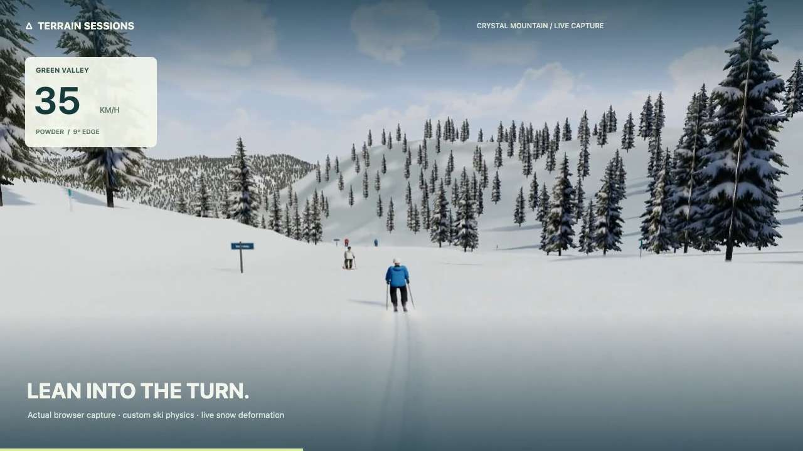

# Terrain Sessions

基于真实地形和地图数据的浏览器 3D 滑雪游戏。沿雪道滑行、留下滑痕，也可以用无人机探索雪场。

**[在线试玩](https://hyjing.github.io/crystal-ski-simulator/)** · [24 秒实机 Demo](docs/media/terrain-demo-current.mp4)

[](https://hyjing.github.io/crystal-ski-simulator/)

## 功能

- **41 条线路**：Crystal Mountain、Snoqualmie 四区、Whistler 和 Blackcomb。
- **滑雪操作**：渐进立刃、转弯控速、收身加速、撑杖、腾空转体与抓板。
- **雪场体验**：粉雪滑痕、天气与光影、NPC、缆车和设施碰撞。
- **自由探索**：无人机跟拍与自由飞行，自定义服装配色和雪板。
- **电脑与手机**：键盘鼠标或触屏操作；手机建议横屏。

## 操作

| 按键 | 操作 |
| --- | --- |
| A / D | 转弯 |
| 空格 | 配合转向搓雪减速 |
| W / Shift | 收身 / 撑杖 |
| J | 起跳，需至少 18 km/h |
| Q / E / F | 空中左转 / 右转 / 抓板 |
| R / N | 返回检查点 / 重新开始 |
| V / Esc | 无人机 / 暂停 |

完整操作说明见游戏内帮助。到达下站绿色光圈后可返回山顶。

## 本地启动

安装 Node.js **20.19+ 或 22.12+**：

```sh
git clone https://github.com/hyjing/crystal-ski-simulator.git
cd crystal-ski-simulator
npm start
```

启动器会安装依赖并打开游戏。也可双击 `启动滑雪.command`（macOS）或 `启动滑雪.bat`（Windows）。

开发检查：`npm test` · 静态构建：`npm run build`

## 技术与数据

Three.js / WebGL · Vite · 自定义滑雪物理 · USGS / Mapzen 高程 · OpenStreetMap 雪道。

[技术说明](docs/TECHNICAL.md) · [资源与许可](docs/ASSETS.md)

独立开发中的原型，与各雪场无关联。地形与线路以真实数据为参考，场景和物理仍有近似，不用于现实导航。
