<div align="center">

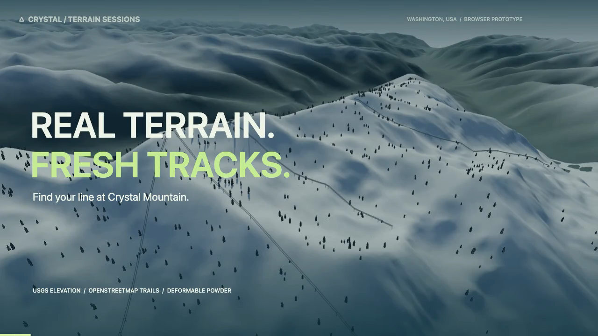

# CRYSTAL / TERRAIN SESSIONS

**循着山势，压进粉雪，把你的线路留在山上。**

Real terrain. Fresh tracks. Your line.

[🎿 直接试玩](https://hyjing.github.io/crystal-ski-simulator/) · [▶ 20 秒实机 Demo](docs/media/crystal-demo.mp4) · [开始滑行](#快速开始) · [技术与数据](docs/TECHNICAL.md)

[](https://github.com/hyjing/crystal-ski-simulator/actions/workflows/pages.yml)

[](https://github.com/hyjing/crystal-ski-simulator/actions/workflows/ci.yml)

**Three.js / WebGL** &nbsp; · &nbsp; **USGS 地形** &nbsp; · &nbsp; **OSM 雪道** &nbsp; · &nbsp; **可变形粉雪**

</div>

## 发给朋友，打开就能滑

**试玩链接：[hyjing.github.io/crystal-ski-simulator](https://hyjing.github.io/crystal-ski-simulator/)**

把这个网页链接发给朋友即可，无需安装、注册或 GitHub 账号。仓库链接用于看源码；试玩请打开上面的网页。

建议用电脑和键盘，手机触控仍在完善。首次载入会下载地形、人物与航拍资源，请等「开始滑行」可点击；选好雪道后按 **Shift** 撑杖离开缓坡站区，**A / D** 转弯，**W** 收身加速。按 **V** 开启无人机跟拍或自由探索，滚轮拉近人物；操作说明在页面顶部。

这是可试玩的早期原型：真实地理参考与游戏外观结合，动作、雪况和设施仍在打磨。遇到问题可以在 [Issues](https://github.com/hyjing/crystal-ski-simulator/issues) 留下雪道名称、浏览器和复现步骤。


---

## 先滑一趟

[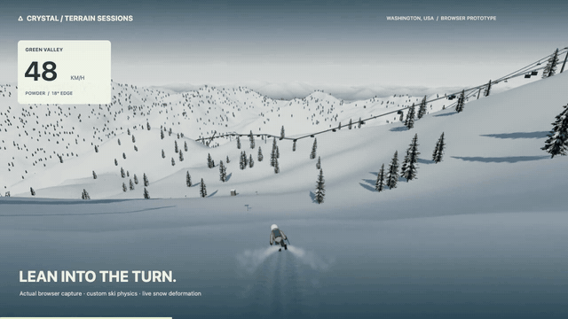](docs/media/crystal-demo.mp4)

**抬头是雪山，脚下是会回应的雪。** 从 Crystal Mountain 的坡面出发，收身顺坡提速，再压刃完成一道弯；雪板滑过的地方，会留下沟槽和堆起的雪边。

这是一个在浏览器里运行的 3D 滑雪原型。山形来自真实高程，雪道沿着实际地图坐标铺设；你可以跟着路标，也可以自由探索坡面。

[下载清晰版 MP4 · 20 秒 / 720p / 约 4.5 MB](docs/media/crystal-demo.mp4?raw=1)

<sub>视频尚未包含站台、人物和天空的最新更新。视频为 v0.3.1 的浏览器实录，由演示脚本提供操控输入；动图截取自同一段录像。下方雷尼尔山截图来自后续远景更新。短片没有背景音乐。</sub>

## 一座山，几种不同的乐趣

| 沿真实山势选线 | 让雪留下你的轨迹 | 用弯形控制节奏 |
| :--- | :--- | :--- |
| USGS 高程还原山脊、坡向和落差，周边山群也有地理位置。 | 近处粉雪会压陷、形成雪边；侧滑与压刃会扬起雪雾。 | 顺坡提速、收身降低风阻，靠转弯和横切控速。 |

<table>
<tr>
<td width="50%">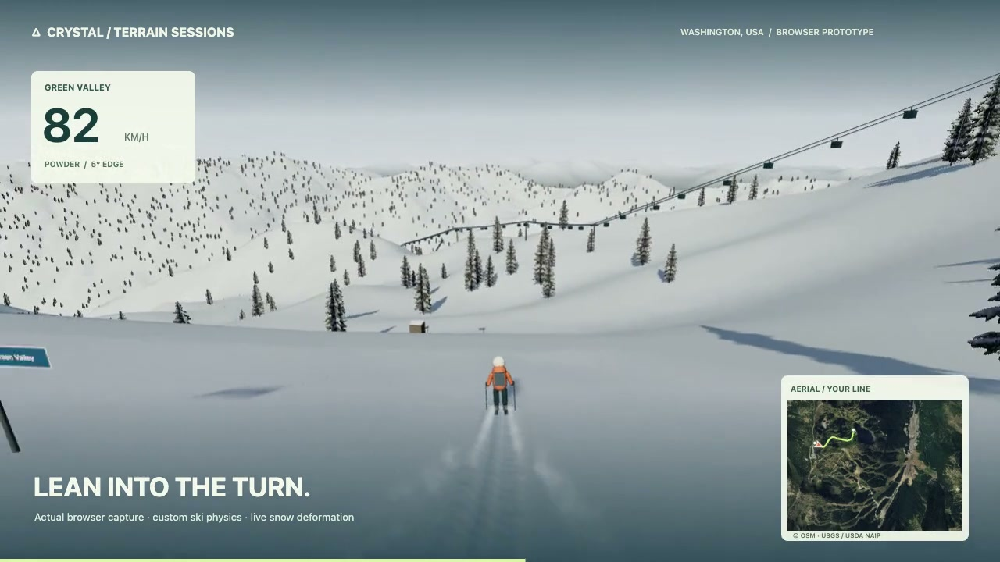<br /><strong>01 / 找到落线</strong><br />低姿态提速，压刃入弯，留下粉雪滑痕。</td>
<td width="50%">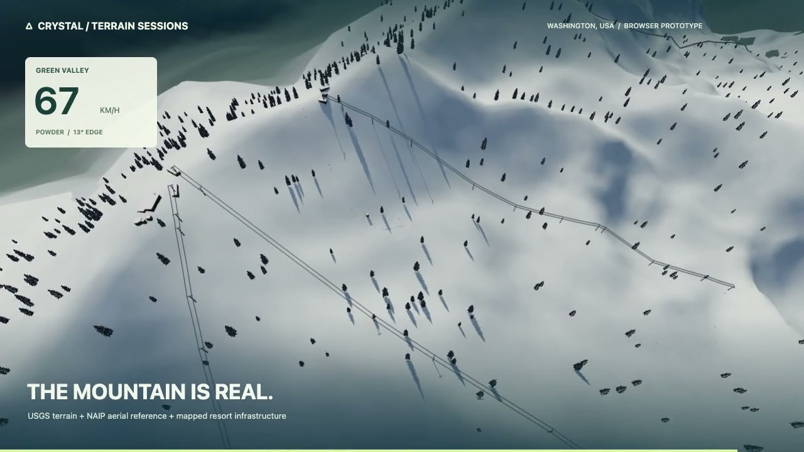<br /><strong>02 / 看见整座山</strong><br />俯瞰真实山形，以及地图坐标上的缆车和雪场设施。</td>
</tr>
</table>

### 抬头，看见雷尼尔山

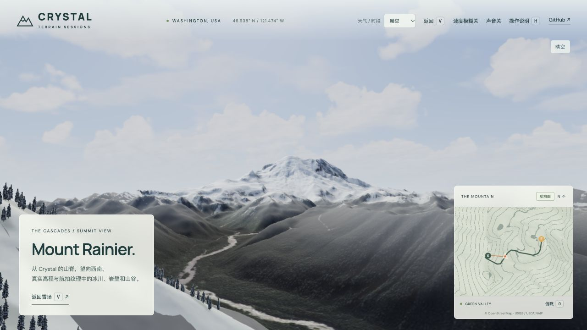

Crystal 远景保留真实方位上的 Mount Rainier，搭配分块拼接的 4K 真实航拍图、加密的山顶和河谷地形，保留冰川沟槽、岩壁、林谷与河床纹理。远景河流来自航拍图，暂未模拟动态水面。固定山脊观景已由无人机替代。

## Snoqualmie 四区，只选长线

在选线页切换 **Summit West / Central / East / Alpental**，共 **14 条约 0.87–2.44 km 的完整行程**。短于 700 米的候选不单独列出，短连接段并入长线；部分行程跨多条雪道，以沿途最高难度标注。每次只加载当前区域的高程、树林、航拍与设施。详细线路和来源见 [Snoqualmie 地图说明](docs/SNOQUALMIE.md)。

## 无人机，换个高度看

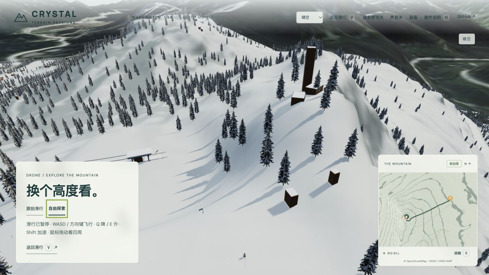

按 **V** 开启高位跟拍，滑雪操作照常；点 **自由探索** 暂停滑行，用 **WASD / 方向键** 飞行、**Q / E** 降低或升高、**Shift** 加速，鼠标拖动看四周。区域远景载入后，自由飞行可扩展至周边约 15–20km 的山谷区域，并保持离地间隙。切回跟拍或退出时恢复原来的滑行位置。遇到平地转入下坡的坡折，普通跟随镜头会提前探测坡下、平滑抬高并拉远，减少坡顶遮挡。

## 远山，也值得停下来看看

Crystal 和 Snoqualmie 各增加一块重新导出的 **3K 区域航拍**，搭配约 **30 / 35m 导出间距的真实高程**。把像素集中用在雪场周围的山脊、林谷和湖岸：区域图约 **5 / 6.5m 地面距离每像素**，外圈远山仍保留原有广域背景，Crystal 的雷尼尔山继续使用独立 4K 图。冬季积雪为渲染处理，水面与植被识别是颜色启发式；不模拟湖水流动。

按 V 切到无人机，在晴空或夕阳下停下来探索。新远景在滑行启动后加载，失败时保留原背景；只加载当前雪场对应的区域，不同时常驻两套高清远景。

## 人物、连弯与近景细节

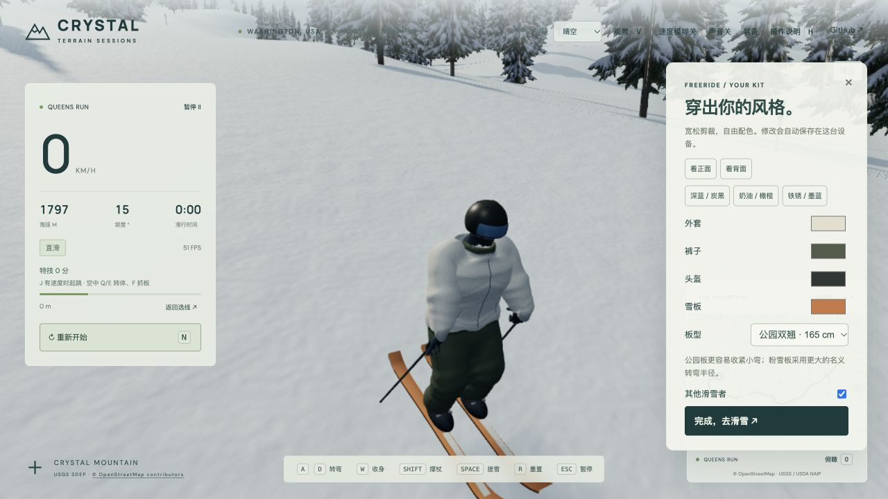

按住转向，逐渐加大立刃；换侧时经过平刃，保留滑行惯性。雪板与髋部随弯形转动，顺坡连弯时胸肩适量朝向落线，横穿和静止时回正跟随雪板；转弯切换时短暂点杖。人物采用连续的宽松滑雪服轮廓，帽兜、衣摆、宽裤管和手套随骨骼运动；整套人物从完整 GLB 加载。滚轮可以拉近查看人物和设施。

## 配一套自己的 Freeride 装备

人物改为翻边针织帽搭配雪镜，缩短外露脖子，并已修正胸肩深度、裆部高度与双腿间隙，收紧不合理的跨肢体蒙皮；上图保留前版装备界面示意。参考来源见 [人物结构说明](docs/CHARACTER_REFERENCES.md)。

顶部 **装备** 可实时预览深蓝 / 炭黑、奶油 / 橄榄、铁锈 / 墨蓝三套配色，也能单独调整外套、裤子、帽子和雪板颜色。剪裁改为更宽大的落肩外套和宽裤管，减少密集环状褶皱。颜色、板型和雪友开关自动保存在本机。

全山、粉雪、公园双翘三种板型会改变板长、板宽、尾翘外观和名义侧切半径；公园板的小弯更灵活，粉雪板偏大弯。转向立刃的建立也更快，持续按住仍会逐渐收紧弯形。

## 凸坡起飞，稳稳落地

速度和坡顶形状足以形成持续腾空时，会按地形曲率和重力自然离地；小起伏会贴雪通过，避免短促反复弹跳。也可按 **J** 加强起跳：为花式玩法提供更高的蹬伸力度，随速度适度增加；平地及中等缓坡上约有 1–1.4 秒的动作窗口。这是有意偏向游戏性的辅助，不改变真实山形、雪道长度或重力。空中用 **Q / E** 转体，按住 **F** 做抓板姿态。横向动量保留，空中转身不会把飞行轨迹拐弯；落地对齐雪板方向，可得腾空、180 / 360、抓板分数。横板或冲击过大的落地会失衡，可恢复后继续，或按 R 回检查点。

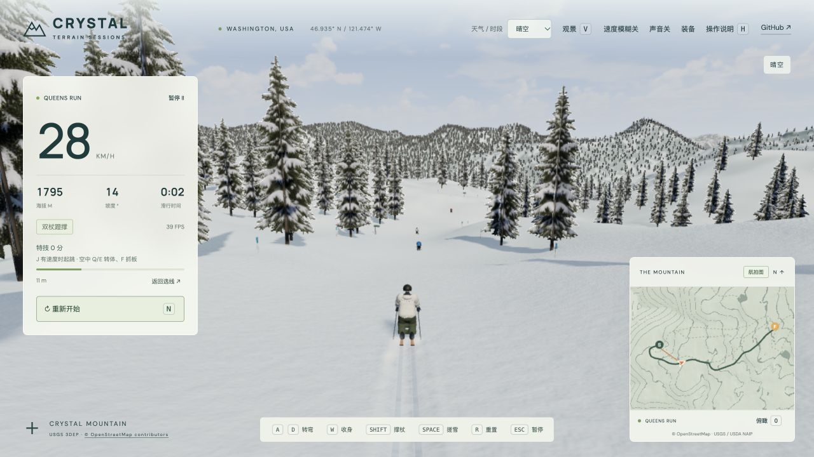

雪场中有 **24 名地面 NPC（18 名滑雪者 + 6 名站房游客），另有 8 名吊椅乘客**。雪友各自连弯、点杖，有快有慢，也会靠边停留、偶尔摔倒后起身。游客沿固定动作序列坐下休息、站起来散步，或开门进入休息小屋再出来；部分游客拿热饮或三明治，步行时双手自然摆动。玩家和 NPC 的摔倒加入渐进侧摔、收拢和起身姿态。地面同屏最多 12 人、吊椅最多 4 人，均可在「装备」关闭；使用本地规则，无需联网 AI 服务，暂不支持联机。雪板按实际底面检查雪面高度，减少入雪穿插。碰撞雪友扣 100 分，在附近恢复并给予短暂免碰撞时间。

房屋、站台支柱与围栏、缆车塔柱和移动吊椅 / 吊厢具有碰撞体积：低速接触阻挡，高速撞击触发摔倒并在附近恢复。头顶经过的吊椅按高度判定，不会挡住地面玩家。设施补充了窗框、积雪坡屋顶、塔柱护垫、吊椅坐垫接缝和吊挂细节；站旁新增可开门的休息小屋与长椅。这些是依据设施类型制作的模型，尚非实景扫描复刻。松开鼠标环视约 1.8 秒后，镜头逐渐回到滑行前方。

## 从缆车站出发

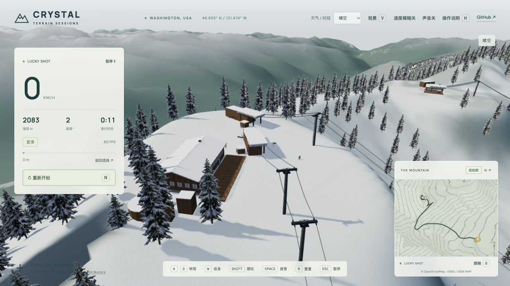

从平缓的卸客区起步，按 Shift 撑杖滑出站台；沿雪道两侧的雪坡与标杆下滑，转横立刃搓雪控速。下站绿色光圈是这一趟的终点，到站后可直接返回山顶。人物采用完整骨骼人形与冬装蒙皮；树木外观、站房细节和局部整地仍是近似。

## 同一座山，不同的天气

右上角 **天气 / 时段** 可随时选择晴空、阴天、风雪和夕阳。天空云层、太阳方向、雪面受光、阴影、远山雾与雪花在约 5 秒内一起过渡；不影响正在进行的滑行。

| 晴空：针叶林与雪坡细节 | 夕阳：暖光与长阴影 | 风雪：降雪与低能见度 |
| :---: | :---: | :---: |
| 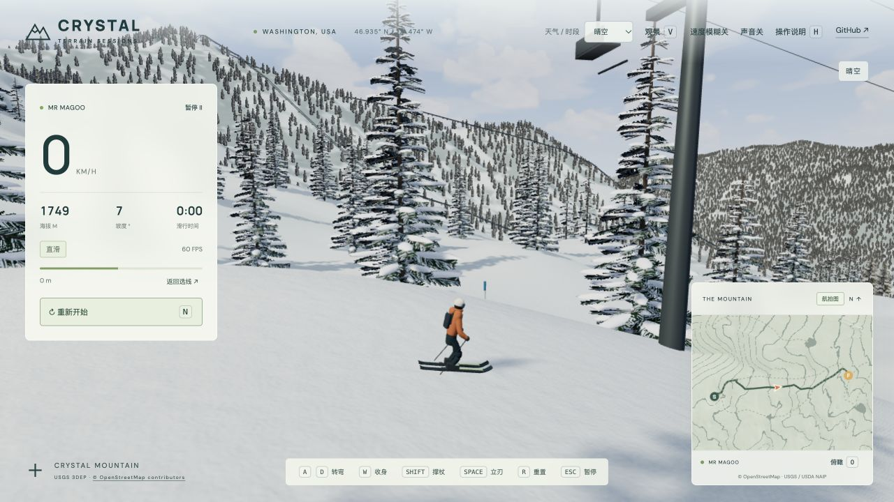 | 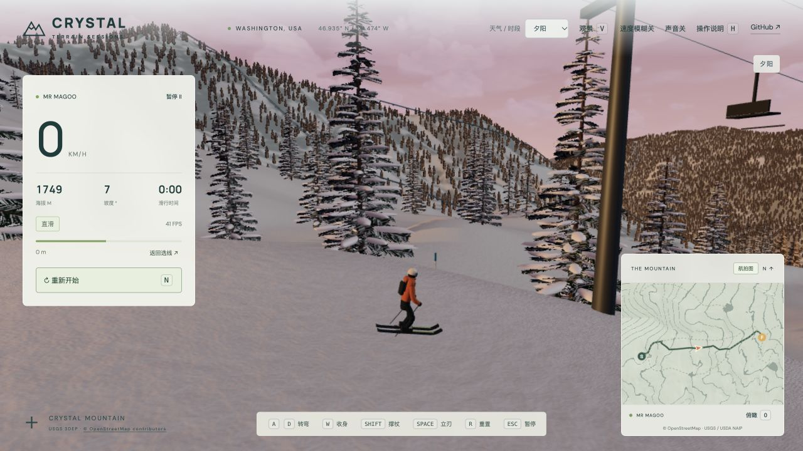 | 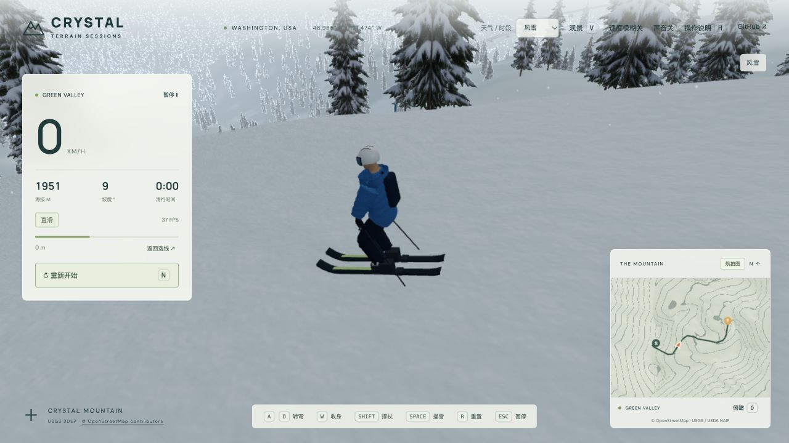 |

树冠采用固定的体积交叉覆雪纹理，配实体树干与独立稳定树影；按区域裁剪绘制，靠近时不再替换树形。细雪法线、侧滑方向喷雪、连续滑痕、身体换重、转弯末点杖与跟随镜头一起表现滑雪接触感。截图为开发检查机位中的实际渲染；天气是美术预设，非实时预报。

## 今天滑哪条？

Crystal Mountain 菜单保留 **11 条缆车整趟路线**，长度约 **0.6–2.8 km**。从上站缓坡出口静止出发，以抵达下站光圈为目标；不足 400 m 的短段不再单独列为一趟，连接段仍保留在线网里。

| 路线 | 缆车 | 本次整趟长度 |
| :--- | :--- | :--- |
| Green Valley | Green Valley | 1.2 km |
| Lucky Shot | Rainier Express | 2.0 km |
| Queens Run（绿道） | Forest Queen Express | 1.9 km |
| Mr Magoo / Chappelle's / Downhill | Forest Queen Express | 1.6 / 1.8 / 1.6 km |
| Gold Hills | Gold Hills | 0.6 km |
| Northway / Otto Bahn | Northway | 2.1 / 2.8 km |
| Quicksilver / Tinkerbell | Quicksilver | 1.1 / 1.3 km |

路线沿 OSM 中心线串联，起终点取缆车端点；站区和少量数据断口的接驳仍是近似。查看 [完整线路、接驳边界与验证范围](docs/TRAILS.md)，以及 [Crystal Mountain 官方雪道地图](https://www.crystalmountainresort.com/the-mountain/trail-maps)。

## 快速开始

**直接玩：** [打开在线版](https://hyjing.github.io/crystal-ski-simulator/)，无需安装。

**本地双击启动：** 下载 / 克隆项目并解压，安装一次 [Node.js](https://nodejs.org/)（20.19+ 或 22.12+），之后：

- macOS：双击根目录的 `启动滑雪.command`。如果下载的 ZIP 未保留执行权限，可在终端进入项目目录执行 `chmod +x 启动滑雪.command`；系统拦截时按提示检查并允许运行。
- Windows：双击 `启动滑雪.bat`。
- 终端通用入口：`npm start`。

启动器自动进入项目目录，首次安装依赖（需要网络），再启动服务并打开浏览器。默认端口被占用时自动选择空闲端口。关闭终端窗口或按 Ctrl+C 停止服务。依赖不变时再次启动会跳过安装；本地版仍需支持 WebGL 的浏览器。

开发者也可以手动运行：

```sh
git clone https://github.com/hyjing/crystal-ski-simulator.git
cd crystal-ski-simulator
npm ci
npm run dev
```

打开终端给出的本地地址，通常是 [http://127.0.0.1:5173](http://127.0.0.1:5173/)。选一条线路，点击「开始滑行」。

线上试玩不需要运行这些命令；以上步骤供本地开发使用。推送到 `main` 后，GitHub Actions 会测试、构建并更新 Pages。部署方式见 [PUBLISHING.md](docs/PUBLISHING.md)。

## 把第一道弯做好

| 操作 | 按键 |
| :--- | :--- |
| 连续立刃转弯 | **A / D** 或 **← / →** |
| 配合转向横板搓雪；转横后保持刹停 | **空格** 或 **↓** |
| 收身，降低空气阻力 | **W** 或 **↑** |
| 连续双杖蹬撑，各速度均可使用 | **Shift** |
| 有速度时起跳 | **J** |
| 空中左 / 右转体，抓板姿态 | **Q / E，F** |
| 从起点重新开始 | **N** |
| 返回最近检查点 | **R** |
| 跟随 / 站区俯瞰镜头 | **O** |
| 环视 / 拉近人物和设施 / 回正 | **拖动 / 滚轮 / C** |
| 无人机跟拍 / 返回 | **V** |
| 无人机自由探索：前后左右 / 降低升高 / 加速 | **WASD 或方向键 / Q、E / Shift** |
| 暂停 / 继续 | **Esc / P** |

**想慢一点？把弯转完整。** 顺着坡面会加速，逐渐横切坡面可以控速。普通连续弯按住 A / D，刃角会随持续时间逐步增大，弯形随之收紧，侧向受力带动实际滑行轨迹；需要横板搓雪时，配合空格与转向；转横后松开转向并保持空格，可以搓雪刹停。出发时按 Shift 撑杖，在缓坡上也能起步。连续滑行中，人物只在完成一侧弯、转向另一侧的换刃附近点杖并回收，单纯松键或同侧续弯不会点杖；这一动作不额外增加推进力。右下角小地图可以切换地形和航拍图。

到达下站绿色光圈后，点击「返回山顶」可以重新出发。

粉雪默认开启。速度模糊可以在顶部切换；当前默认关闭，以优先保证清晰度和流畅度。

## 地形有出处，细节在生长

- **山形**：USGS 3DEP 高程；滑行区域约 4.93 m 导出采样（约 19.7 m 备份），雷尼尔山约 36 m，周边山群约 60 m。导出间距不代表原始测绘精度。
- **雪道与设施**：© OpenStreetMap contributors，ODbL 1.0；使用雪道中心线、缆车路径与建筑轮廓。
- **林地参考**：公开的 USGS / USDA NAIP 无雪季航拍。从林冠纹理提取约 5.6 万个树木候选位置，并提供远处林地覆盖与航拍小地图；单株位置仍是估算。
- **冬季外观**：粉雪层、滑痕、雪雾和站房外观由项目制作；冷杉使用固定覆雪纹理与实体树干。人物基于 Quaternius CC0 骨骼人形，冬装、头盔与滑雪动作由项目适配。
- **站区与雪道边缘**：上下站机械、缓坡登乘区、Summit House 与 Campbell Basin Lodge；雪道增加推断宽度的雪坡边缘和标杆。局部整地与建筑外观为人工近似。
- **天空**：Poly Haven CC0 实拍 HDRI 提供云形细节与弱环境反射，叠加统一的天空 / 天气着色；并非 Crystal 当地拍摄或实时天气。

这是独立的早期原型，与 Crystal Mountain Resort 无关联。雪层形变属于视觉高度场模型，树林位置和建筑外观仍是近似；它不用于现实雪场导航，腾空和落地仍是简化玩法模型，尚无完整刚体碰撞或人体生物力学。

## 继续往山里走

- [x] Crystal 11 条 + Snoqualmie 四区 14 条长线、难度筛选与搜索
- [x] 粉雪压痕、雪边与雪雾
- [x] 转弯、立刃、收身与检查点
- [x] 航拍地图、覆雪林地、缆车与建筑
- [x] 雷尼尔山细化地形、航拍远景与无人机探索
- [x] GPU 粉雪更新、输入响应和帧时间优化
- [x] 关节滑行动作、双杖动作与近景 3D 植被
- [x] 缆车上下站、站区缓坡与到站返回
- [x] 晴空 / 阴天 / 风雪 / 夕阳，同步天空、光照与能见度
- [x] 完整骨骼人形、冬装蒙皮、上下身分离与渐进立刃
- [x] 固定树形、稳定阴影与风雪雾层
- [ ] 继续提高人物服装纹理与场景资源精度
- [ ] 更准确的冬季雪道边界与场景资源
- [ ] 用实拍和测量校准速度、抓地与雪感

## 打开引擎盖

| 想了解什么 | 从这里开始 |
| :--- | :--- |
| 架构、物理参数、数据坐标和导入命令 | [技术说明](docs/TECHNICAL.md) |
| 卡顿优化、帧耗时和可复现测量 | [性能记录](docs/PERFORMANCE.md) |
| 航拍、OSM、生成素材和完整提示词 | [资源来源](docs/ASSETS.md) |
| 已验证内容与当前边界 | [验证记录](docs/VALIDATION.md) |
| 完整线路目录与通行验证边界 | [线路目录](docs/TRAILS.md) |
| 后续开发范围 | [Scope](docs/SCOPE.md) |
| Demo 的录制与编码方式 | [媒体说明](docs/media/README.md) |

```sh
npm test              # 物理、地形、路线与粉雪回归检查
npm run build         # 生成静态构建
npm run bench:powder  # CPU 粉雪更新测量
```

<div align="center">

**下一趟，换一条线。**

Built on real terrain. Still finding its edges.

</div>
